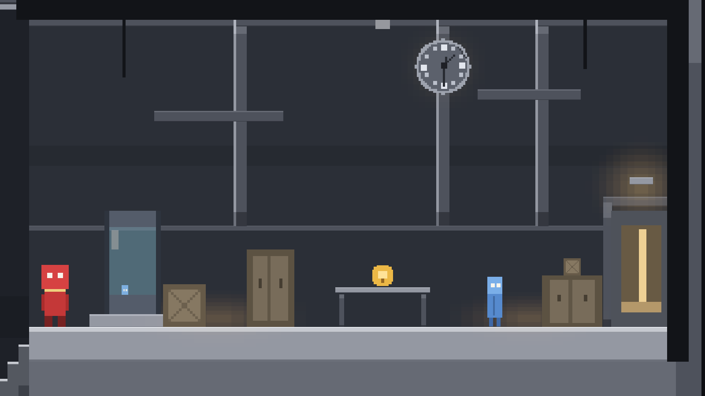

# 第 25 小时 · 第 0 层白盒（Shelter L0）

一句「一天里的第 25 小时」的项目，这是它的第一块可玩白盒：**避难所 1 区**，2D 横版，1F + 楼梯井 + B1 三层空间。

Unity **2022.3.62f3c1** · URP 未启用（内置管线）· 全部美术是代码生成的占位图，可以随时换。



---

## 快速开始

1. Unity Hub → Add → 选这个文件夹（`ProjectSettings/ProjectVersion.txt` 已经是 2022.3.62f3c1）
2. 打开 `Assets/Scenes/Shelter_L0.unity`
3. 点 Play
4. 菜单 **工具 → 25小时 → 一键：重建 + 截图 + 打包** 可以从零重新生成全部场景、占位图、预览图和 Windows 包

没有装 Unity 也能玩：解压 [`dist/25Hours_2_可运行包_Win64.zip`](dist/) 双击 `25Hours.exe`。

### 操作

| 键 | 作用 |
| --- | --- |
| `A` `D` / `←` `→` | 移动（楼梯是隐形斜坡，自动贴合） |
| `空格` | 跳跃 |
| `E` | 交互（翻碎片 / 对话 / 进门） |
| `E` / `空格` / 鼠标 | 对话继续 |
| `Esc` | 关闭对话 |

## 这一层里有什么

- **1F**：展柜（事件后多一个人偶）、纸箱、柜子、桌子 + 回声匣、人偶、书架 + 玻璃罐、东墙的 **门·事件一**
- **楼梯井**：20 级台阶（纯视觉）+ 一条隐形斜坡碰撞
- **B1**：工作台、旧收音机、人偶、抽屉柜、线缆盘、木箱，暗角里的 **门·事件二**
- **6 个碎片** 散在两层，捡到会进右上角计数
- **回声匣**只对话，不再直接把玩家传进事件
- **两个事件场景是纯空房间**：只有相机 + `EventRoomTemplate`，连一个字都没有，留给事件负责人自己铺玩法（按 `E` 算完成、`Esc` 直接返回）

### 两扇门与解锁链

```
出生 → 探索 1F / B1 → 捡碎片、看回声匣
                    ↓
             门·事件一（1F 东墙，随时能进）
                    ↓ 完成事件一（棋盘点亮 → Complete()）
             门·事件二 自动解锁（门片变暖光、门口光变金色）
                    ↓
             门·事件二（楼梯下暗角）
```

解锁条件是门上的 `requiresEventId`，不需要写任何特殊判断：

```csharp
// Assets/Scripts/EventDoor.cs
public bool IsLocked =>
    !string.IsNullOrEmpty(requiresEventId) && !GameProgress.Ensure().IsEventCleared(requiresEventId);
```

## 文字 / 剧情（现在全部留空，之后再加）

这一版只搭场景和交互，**所有剧情台词都清空了**，交互只给中性的功能反馈：

| 交互 | 现在的反馈 |
| --- | --- |
| 6 个碎片 | 右上角计数 + toast「碎片 n / 6」 |
| 人偶 / 展柜 / 回声匣 | toast「（这段文字之后再加）」 |
| 门还锁着 | toast「门锁着 · 要先完成前置事件」 |
| 门开着 | 直接进事件场景（不弹对话） |
| 门后没接事件 | toast「（这扇门后面还没接事件）」 |

之后要补文字，任选一种：

1. **直接在场景里填**：选中物体，填 `DialogueProp.lines` / `linesAfterEvent`、`FragmentPickup.lines`、`EventDoor.lockedLines / enterLines / clearedLines`（`lines` 一有内容，交互就自动弹对话框）。
2. **改生成器**：`Assets/Editor/Level0Builder.cs` 的 `BuildInteractables()` 里加台词数组。注意重建（`工具/25小时/一键：重建 + 截图 + 打包`）会用生成器的内容覆盖场景里手填的东西。

## 给事件 / 棋盘负责人的接入点

`Event_01.unity` / `Event_02.unity` 现在是空模板，棋盘玩法由别人接。三种接入路线、API 清单、命名与层级约定都写在
**[README_事件接入.md](README_事件接入.md)**。

核心就三条：

```csharp
public class 回声室棋盘 : EventRoomBase      // 1. 场景里挂一个继承它的脚本
{
    protected override void Start() { base.Start(); }

    void 解谜成功() => Complete();            // 2. 点亮全部格子后调用：记录完成 + 回避难所
    void 玩家退出() => Leave();               //    中途退出：不记录完成
}
```

```csharp
GameProgress.Ensure().IsEventCleared("event_01");   // 3. 读进度
GameProgress.Ensure().AddFragment("frag_07");
```

## 场景结构

`Shelter_L0` 的 `World` 下按层分组，方便手动微调：

| 组 | 内容 | 碰撞 |
| --- | --- | --- |
| `01_建筑` | 地板、墙、楼梯 | 只有这层是实心 |
| `02_家具` | 桌面、工作台、管道 | 无 |
| `03_可交互` | 碎片、对话物、两扇门 | Trigger（9 层） |
| `04_角色` | 玩家、相机 | |
| `05_灯光` | 顶灯、吊灯、事件后的光晕 | |
| `06_系统` | 事件登记表、自测 | |
| `07_细节` | 墙裙、墙筋、横梁、挂钟、光池、门框、B1 杂物 | 无 |
| `08_前景` | 顶梁、右框、悬线（sortingOrder 30） | 无 |

层：`Ground = 8`（可站立）、`Interactable = 9`（可交互）。

## 自测

打包版支持一个 `-selftest` 参数，自动把整条流程走一遍并截图：

```powershell
25Hours.exe -selftest -screen-width 1280 -screen-height 720 -screen-fullscreen 0
```

15 张截图在 [`docs/selftest`](docs/selftest)；加 `-fps` 会在日志里每秒打一行帧率和最差一帧耗时，日志在 `%USERPROFILE%\AppData\LocalLow\Zhao\第25小时\Player.log`。

## 一起改

想被加成协作者、一起改工程？流程、约定和坑都写在 **[CONTRIBUTING.md](CONTRIBUTING.md)**（Unity 版本、哪些文件别手改、场景冲突怎么办、Smart Merge 配置、自测命令）。

## 下载

| 包 | 内容 |
| --- | --- |
| [`dist/25Hours_2_可运行包_Win64.zip`](dist/) | Windows 64 位可运行版 |
| [`dist/25Hours_3_截图.zip`](dist/) | 4 张预览 + 15 张自测 |
| [`dist/25Hours_4_白盒生成脚本.zip`](dist/) | 只有 Editor / Scripts 的脚本 |

## 已知限制

- 美术全是 Editor 脚本画的占位图（`Assets/Art` 是生成物，删了能重建）
- 中文字体用 Windows 自带的 SimHei，**没有进仓库**；生成器会从 `C:\Windows\Fonts\simhei.ttf` 自动复制。发布前请换成可商用字体
- 事件场景是纯空房间（无文字/无 UI），棋盘还没接；这里只保证「进门 → Complete() → 回原位」这条链路是通的
- 手感：物理步长固定 1/60 秒、渲染跟随垂直同步（这台机器 165Hz）、HUD 提示只在文字变化时重建，不会再每帧刷 UGUI
- 菜单「重建第0层」会整个覆盖 `Shelter_L0` / `Event_01` / `Event_02`，想在场景里手改的请先另存

## 参考

白盒阶段的做法参考了 [The Level Design Book · Blockout](https://book.leveldesignbook.com/process/blockout) 与 [How to make a level](https://book.leveldesignbook.com/process/overview)：先定体量与尺度、用光照和地标做寻路，把美术留到最后。
