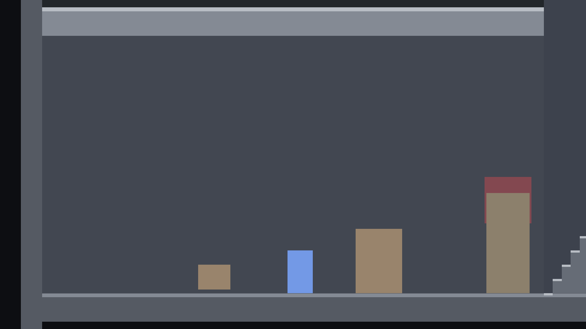
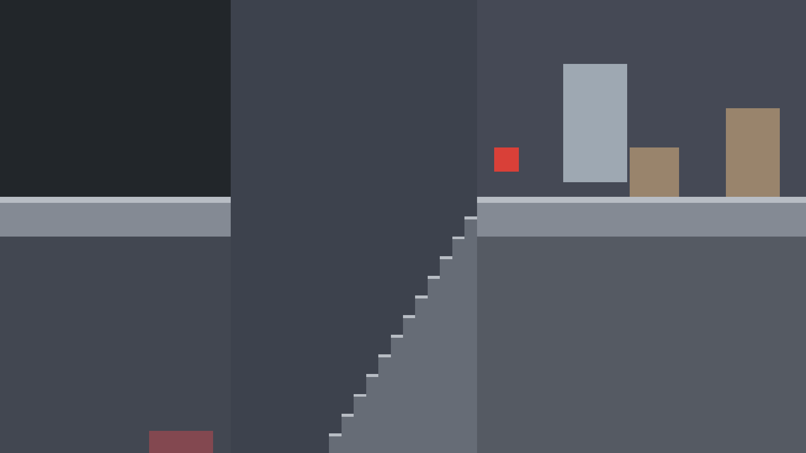
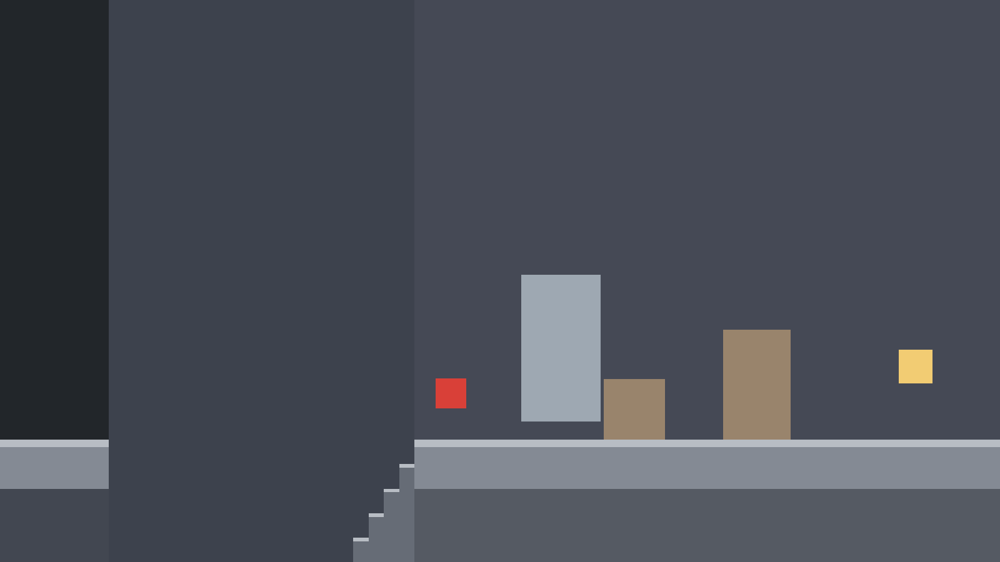

# 第25小时 · 第0层白盒

《第25小时》的 Unity 2D 项目，本仓库包含第 0 层「避难所 1 区」的可玩白盒场景。

场景为单张横版场景，含 1F、楼梯井与 B1 两层空间：6 个可收集碎片、若干可查看的物件、两扇通向事件场景的门，以及「完成事件一后解锁事件二」的进度链。白盒只用一块白方块，物件靠颜色区分，不含任何美术资源；交互台词暂未填写，事件场景为空房间，供棋盘 / 事件玩法负责人接入。

- Unity 版本：`2022.3.62f3c1`
- 目标平台：Windows（Standalone）
- 场景：`Shelter_L0`（第 0 层）、`Event_01`、`Event_02`（空模板）

## 截图

| 1F | B1 |
| --- | --- |
|  |  |

| 楼梯井 | 出生点 |
| --- | --- |
|  |  |

更多过程截图见 `docs/selftest/`。

## 快速开始

```powershell
git clone git@github.com:zjh01300031/25Hours.git
```

1. Unity Hub 添加 `25Hours` 目录，使用 Unity `2022.3.62f3c1` 打开
2. 打开 `Assets/Scenes/Shelter_L0.unity`
3. Play

首次导入时，`Assets/Fonts/SimHei.ttf` 会自动从 `C:\Windows\Fonts\simhei.ttf` 复制进来（仓库不包含字体文件），缺失时中文 UI 会显示为方块，执行一次 `工具 / 25小时 / 重建第0层（白盒）` 即可补齐。

不安装 Unity 也可以直接运行 `dist/25Hours_2_可运行包_Win64.zip` 解压后的 `25Hours.exe`。

## 操作

| 按键 | 作用 |
| --- | --- |
| `A` / `D`、`←` / `→` | 左右移动 |
| `空格` | 跳跃（0.08s 土狼时间，0.1s 输入缓冲） |
| `E` | 与最近的物件交互 |
| `Esc` | 返回；在事件场景中直接回第 0 层 |

## 场景与流程

```
1F ── 展柜 / 纸箱 / 柜子 / 桌子 · 回声匣 / 人偶 / 书架 · 玻璃罐 / 门 · 事件一（东墙）
 │
楼梯井 ── 20 级台阶（纯视觉）+ 隐形斜坡碰撞
 │
B1 ── 工作台 / 旧收音机 / 人偶 / 抽屉柜 / 线缆盘 / 木箱 / 门 · 事件二（暗角）
```

流程：出生 → 探索两层、收集碎片 → 进入「门 · 事件一」→ 在事件场景中调用 `Complete()` → 返回后「门 · 事件二」自动解锁 → 进入事件二。

事件二的解锁条件写在门的 `requiresEventId` 字段上，不需要额外代码：

```csharp
// Assets/Scripts/EventDoor.cs
public bool IsLocked =>
    !string.IsNullOrEmpty(requiresEventId) && !GameProgress.Ensure().IsEventCleared(requiresEventId);
```

## 仓库结构

```
Assets/
  Art/                 白方块贴图（由脚本生成，勿手改）
  Editor/              白盒生成器、工具箱、贴图生成
  Scenes/              Shelter_L0 / Event_01 / Event_02
  Scripts/             玩家、交互、进度、事件接入
docs/
  preview/             场景预览图
  selftest/            自测流程截图
  whitebox.md          白盒细节：分层、坐标、微调
  event-integration.md 事件 / 棋盘玩法接入说明
dist/
  25Hours_2_可运行包_Win64.zip
  25Hours_3_截图.zip
  25Hours_4_白盒生成脚本.zip
```

场景在 `World` 下按层分组，便于手动调整：

| 组 | 内容 | 碰撞 |
| --- | --- | --- |
| `01_建筑` | 地板、墙、楼梯 | 实心 |
| `02_家具` | 展柜台座、桌子、工作台、管道 | 无 |
| `03_可交互` | 碎片、对话物、两扇门 | Trigger |
| `04_角色` | 玩家、相机 | — |
| `05_灯光` | 顶灯、吊灯、事件后的光晕 | — |
| `06_系统` | 事件登记表 | — |
| `07_细节` | 墙裙、墙筋、横梁、挂钟、门框 | 无 |
| `08_前景` | 顶梁、侧框、悬线 | 无 |

物理层：`Ground = 8`、`Interactable = 9`。

## 构建与自测

菜单 `工具 / 25小时`：

- `重建第0层（白盒）`：重新生成白方块贴图、字体、三个场景与 Build Settings
- `白盒工具箱`：网格对齐、快速加平台、打开场景
- `一键：重建 + 截图 + 打包`：以上全部，输出到 `D:/Unity2D/Build/25Hours`

命令行（无编辑器界面）：

```powershell
& "Unity.exe" -batchmode -quit -projectPath "D:\Unity2D\Projects\25Hours" `
  -executeMethod Level0Builder.BuildEverything -logFile build.log
```

流程自测（不需要人工操作）：

```powershell
.\25Hours.exe -selftest -screen-width 1280 -screen-height 720 -screen-fullscreen 0
```

自测会走完「出生 → 下楼 → 取碎片 → 试锁门 → 事件一 → 返回 → 事件二 → 返回」全流程，逐段截图到 `D:/Unity2D/Build/25Hours/selftest`，并把坐标写入 Player.log：

```
%USERPROFILE%\AppData\LocalLow\Zhao\第25小时\Player.log
```

帧率记录：加 `-fps` 参数，日志每秒输出一次当前帧率与最差帧耗时。

## 文字 / 剧情

当前版本只包含场景与交互，剧情台词为空，交互只提供功能性反馈：

| 交互 | 反馈 |
| --- | --- |
| 碎片 | 右上角计数 + 提示「碎片 n / 6」 |
| 人偶 / 展柜 / 回声匣 | 提示「（这段文字之后再加）」 |
| 门锁着 | 提示「门锁着 · 要先完成前置事件」 |
| 门可进入 | 直接切换到事件场景 |
| 门后未接入事件 | 提示「（这扇门后面还没接事件）」 |

补充台词有两种方式：

1. 在场景中选中物体，填写 `DialogueProp.lines` / `linesAfterEvent`、`FragmentPickup.lines`、`EventDoor.lockedLines / enterLines / clearedLines`；字段有内容时会自动弹出对话框。
2. 修改 `Assets/Editor/Level0Builder.cs` 的 `BuildInteractables()`。注意重建会用生成器的内容覆盖场景中手填的台词。

## 事件 / 棋盘接入

`Event_01` / `Event_02` 为空模板，只有相机与 `EventRoomTemplate`。接入方式、API 与约定见 [docs/event-integration.md](docs/event-integration.md)。

```csharp
public class Event01Board : EventRoomBase
{
    protected override void Start() { base.Start(); }

    void OnBoardSolved() => Complete();   // 记录完成并返回第 0 层
    void OnQuit()       => Leave();       // 中途退出，不记录完成
}
```

## 现状与已知限制

- 没有任何美术资源：场景里所有物件共用一块 8×8 白方块，颜色在 `Level0Builder.TintFor` 里按用途给；正式美术替换物件的 sprite 即可
- 中文使用系统字体 SimHei，字体本身不随仓库分发
- 事件场景为空房间，玩法未实现
- 白盒重建会覆盖 `Shelter_L0`、`Event_01`、`Event_02` 三个场景，手改前请先另存

## 贡献

见 [CONTRIBUTING.md](CONTRIBUTING.md)。

## 参考

- [The Level Design Book · Blockout](https://book.leveldesignbook.com/process/blockout)
- [The Level Design Book · How to make a level](https://book.leveldesignbook.com/process/overview)

## 许可

尚未添加开源许可，对外分发前请先确认。
