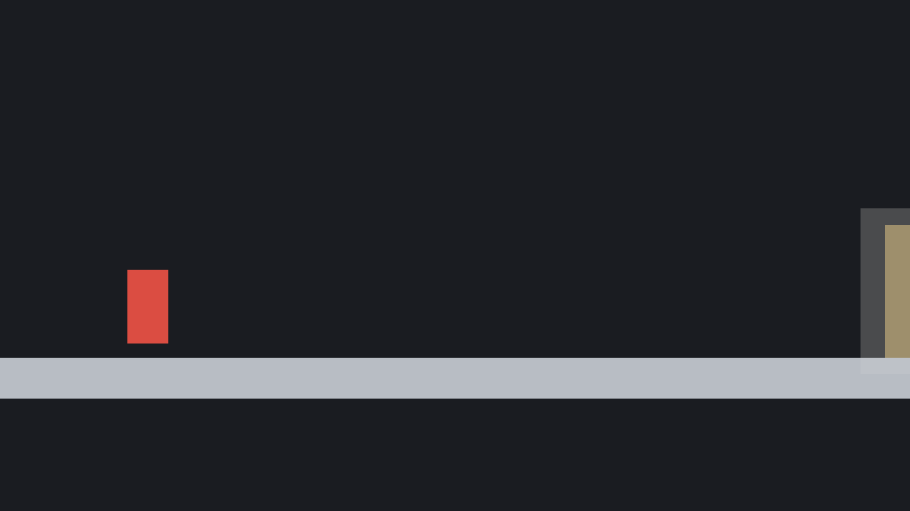
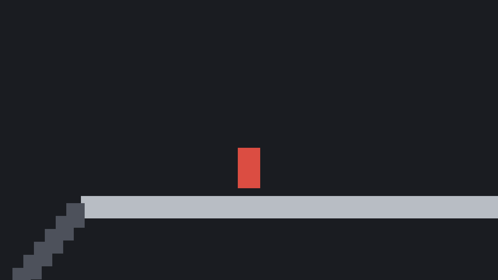
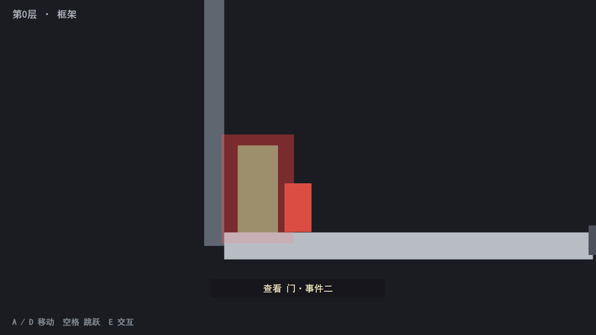
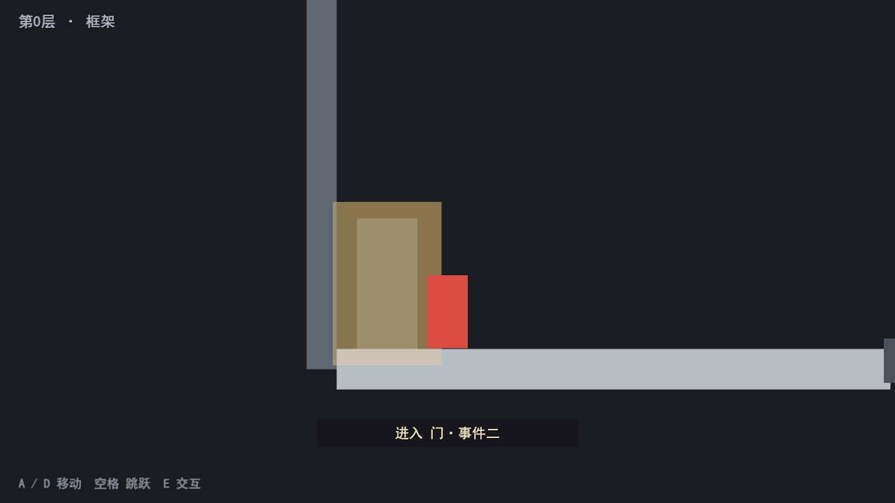

# 第25小时 · 第0层框架

《第25小时》第 0 层的可运行框架：两层空间、楼梯、两扇事件门，以及「完成事件一后解锁事件二」的进度链。

这一层只负责「能跑、能测交互」：没有任何美术资源（所有物件共用一块白方块，靠颜色区分），没有台词，两个事件场景是空房间，留给关卡和玩法负责人往里填内容。

- Unity 版本：`2022.3.62f3c1`
- 目标平台：Windows（Standalone）
- 场景：`Shelter_L0`（第 0 层）、`Event_01`、`Event_02`（空模板）

## 截图

| 1F | 楼梯 | B1 |
| --- | --- | --- |
|  |  |  |

| 出生点 | 事件二的门（锁着） | 事件一完成后的门 |
| --- | --- | --- |
|  |  |  |

完整流程截图（11 张）见 `docs/selftest/`。

## 快速开始

```powershell
git clone git@github.com:zjh01300031/25Hours.git
```

1. Unity Hub 添加仓库目录，用 Unity `2022.3.62f3c1` 打开
2. 打开 `Assets/Scenes/Shelter_L0.unity`
3. Play

中文字体不进仓库：首次构建时 `Assets/Fonts/SimHei.ttf` 会从 `C:\Windows\Fonts\simhei.ttf` 自动复制；没有字体时 UI 中文会显示成方块。

不装 Unity 也可以直接跑 `dist/25Hours_2_可运行包_Win64.zip` 里的 `25Hours.exe`。

## 操作

| 按键 | 作用 |
| --- | --- |
| `A` / `D` | 左右移动（斜坡、楼梯自动贴着走） |
| `空格` | 跳跃（空中不可二段跳，落地有土狼时间） |
| `E` | 与附近的门交互 |
| `Esc` | 关闭提示 |

## 这一层里有什么

```
1F  ── 地面（x -6 … 16）、右墙
 │
楼梯 ── 13 级视觉台阶 + 一条看不见的斜坡碰撞体（-6,0 → -11,-6）
 │
B1  ── 地面（x -22 … -11）、左墙
```

| 物件 | 位置 | 说明 |
| --- | --- | --- |
| 玩家（主控） | `(0, 1)` | 默认出生点，`ShelterPlayer.spawnPoint` 可改 |
| 门·事件一 | `(15, 1.3)` | `eventId = event_01`，没有前置条件 |
| 门·事件二 | `(-21, -4.7)` | `eventId = event_02`，`requiresEventId = event_01` |
| 事件登记表 | `04_系统` | `EventCatalog`，id → 场景名 |

门的两种状态：锁着（红色光晕 + `查看` 提示）与解锁（暖色光晕 + `进入` 提示）。解锁条件的唯一来源是 `GameProgress.IsEventCleared(requiresEventId)`，所以任何事件只要调用一次 `Complete()` 就能开锁。

## 事件怎么接进来

事件场景里挂一个继承 `EventRoomBase` 的脚本，玩法完成时调 `Complete()`；中途退出调 `Leave()`。

```csharp
public class MyEventRoom : EventRoomBase
{
    void Update()
    {
        if (/* 棋盘全部点亮 */) Complete();   // 记录完成 + 回到避难所
    }
}
```

加一个新事件三步：

1. 复制 `Assets/Scenes/Event_01.unity` 改名，在场景里挂上自己的 `EventRoomBase` 子类
2. 场景加入 Build Settings
3. 在 `Shelter_L0` 的 `事件登记表` 里加一条 `id → 场景名`，门上的 `eventId` 填同一个 id；需要前置条件就填 `requiresEventId`

进度、碎片计数都在 `GameProgress`（`DontDestroyOnLoad`，跨场景保留）；场景切换用 `ShelterFlow`。详细 API 见 [docs/event-integration.md](docs/event-integration.md)。

## 构建与自测

菜单 `工具 / 25小时`：

| 菜单项 | 作用 |
| --- | --- |
| 重建第0层（框架） | 重新生成 `Shelter_L0` / `Event_01` / `Event_02` |
| 打开第0层并运行 | 打开避难所场景并进入 Play |
| 重建并截图 | 重建后渲染 4 张预览图到 `D:/Unity2D/Build/25Hours/preview` |
| 一键：重建 + 截图 + 打包 | 上面三步 + 打 Windows 包到 `D:/Unity2D/Build/25Hours/25Hours.exe` |
| 截图预览（世界） | 只出预览图 |
| 构建 Windows 试玩版 | 只打包 |

自测（走楼梯、跳、两扇门、解锁链，出 11 张图并退出）：

```powershell
D:\Unity2D\Build\25Hours\25Hours.exe -selftest -screen-width 1280 -screen-height 720 -screen-fullscreen 0
```

截图输出到 `D:/Unity2D/Build/25Hours/selftest`，日志在 `%USERPROFILE%\AppData\LocalLow\Zhao\第25小时\Player.log`。

## 仓库结构

```
Assets/
  Editor/       WhiteBoxArt（白方块 + 字体）、WhiteBoxUI、Level0Builder（生成场景）
  Scripts/      GameProgress、ShelterFlow、EventCatalog、EventDoor、EventRoomBase、
                ShelterPlayer、ShelterInteractor、ShelterDialogue、ShelterHUD、CameraRig2D…
  Scenes/       Shelter_L0、Event_01、Event_02
  Whitebox/     white.png —— 8×8 纯白贴图，全场景共用
  Fonts/        字体（.gitignore 里，构建时自动补齐）
docs/           白盒说明、事件接入说明、截图
dist/           打包产物（源码 / 可运行包 / 截图 / 脚本 / 文档）
legacy/         2024-11 旧原型，仅存档
```

## 现状与限制

- **没有美术**：一块白方块 + 颜色。真美术后期替换
- **没有台词**：交互只给功能反馈（门开 / 门锁 / 进度）
- **没有关卡设计**：房间尺寸、家具、碎片摆放都留给人来做
- **事件场景是空房间**：棋盘 / 玩法由事件负责人接入
- 视觉上只有 1F、楼梯、B1 三段，够验证「上楼 / 下楼 / 进门 / 解锁」

## 贡献

见 [CONTRIBUTING.md](CONTRIBUTING.md)。改场景前先看「谁维护哪个场景」，重建会覆盖 `Shelter_L0` / `Event_01` / `Event_02`。

## 参考

- [The Level Design Book · Blockout](https://book.leveldesignbook.com/process/blockout)
- [The Level Design Book · How to make a level](https://book.leveldesignbook.com/process/overview)

## 许可

代码部分可自由使用；字体为 Windows 系统自带，不随仓库分发。
